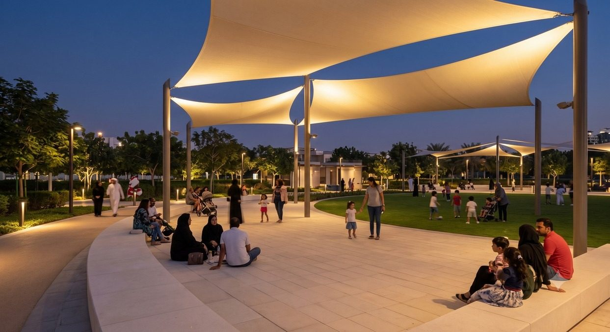

# Al Safa 2 Park — The Threshold Park

Concept and preliminary design for **Al Safa 2 Park** (Al Safa Second, Dubai), my solo entry to Dubai Municipality's
**AI-Powered Park Design Challenge (2026)**.

**Website:** https://assim-ben-ahmed.github.io/al-safa-2-park/ — a one-page tour of the project with the concept animation,
masterplan, renders and every deliverable.



## The project in short

Al Safa 2 is an active 14,841 m² neighbourhood park next to a school, a physiotherapy and rehabilitation centre, a mosque
and family homes. The redesign starts from one verified finding: the site's four edges get measurably different sun, wind
and neighbour exposure. "The Threshold Park" answers each edge differently:

| Zone | Edge | Programme |
|---|---|---|
| Arrival Commons | SE | Sheltered entrance plaza, gateway, drop-off |
| Shaded Promenade | NE | 3 m jogging/walking path under five shade canopies, nature play |
| Central Green Commons | Centre | Toddler (200 m²) and junior (300 m²) playgrounds, event lawn, picnic grove |
| Active Edge | SW | Quiet turf facing the mosque → shaded seating → padel and FIBA 3x3 courts |
| Buffer Grove | NW | Windbreak planting, restroom, service gate |

Key figures:

- **3 concepts scored** against the same confirmed constraints: Central Spine 15/30, Concentric Core 13/30, Threshold Park 30/30
- **62 of 74 existing trees kept** (84%)
- **397.9 m accessible path network** reaching every element, connectivity checked in the geometry
- **Playground shade 76.5% / 73.7%**, after finding the first masterplan had 0% against Dubai Municipality's 70–80% requirement
- **Indicative cost AED 3.3M–7.5M** for the priced scope (9–22% of the AED 35M budget; a floor, not a tender figure)

## AI methodology

| Tool | Role |
|---|---|
| Claude | Strategy, narrative, spatial and data reasoning, independent verification |
| Claude Code | DWG/DXF parsing, geometry, OpenStreetMap queries, GIS analysis, layout generation |
| Gemini Pro / Nano Banana | Renders, masterplan visualisation, mood boards |
| GPT Pro | Critique and proofreading only |

Every claim is tagged **confirmed**, **inferred** or **gap**. Cross-checking outputs against each other and against the raw
geometry caught seven real errors before submission (an ambiguous CAD boundary, a mislabelled area, dropped path
connections, a wrong padel wall height, the playground shade gap, a wrong playground standard, and a drifting render).
Full log: [Deliverable 10](deliverables/10-ai-methodology-report.pdf).

## Deliverables

| # | Document |
|---|---|
| 1 | [Site Analysis & Human-Centric Research](deliverables/01-site-analysis-and-human-centric-research.pdf) |
| 2 | [Design Narrative & Concept](deliverables/02-design-narrative-and-concept.pdf) |
| 3 | [Concept Plans & Spatial Organization Diagrams](deliverables/03-concept-plans-and-spatial-organization-diagrams.pdf) |
| 4 | [Preliminary Design Masterplan](deliverables/04-neighborhood-park-preliminary-design-masterplan.pdf) |
| 5 | [Key Sections & Elevations](deliverables/05-key-sections-and-elevations.pdf) |
| 6 | [3D & Spatial Visualizations](deliverables/06-3d-and-spatial-visualizations.pdf) |
| 7 | [Material & Landscape Palette](deliverables/07-material-and-landscape-palette.pdf) |
| 8 | [User Experience & Activation Strategy](deliverables/08-user-experience-and-activation-strategy.pdf) |
| 9 | [Sustainability Concept & Strategy](deliverables/09-sustainability-concept-and-strategy.pdf) |
| 10 | [AI Methodology Report](deliverables/10-ai-methodology-report.pdf) |
| 11 | [Complete Design Report](deliverables/11-complete-design-report.pdf) |
| 12 | [Concept animation (1 min 40)](assets/video/concept-animation.mp4) |

## Repository layout

```
index.html          the website (single static page, no build step)
assets/img/         renders and diagrams taken from the deliverables
assets/video/       the one-minute concept animation
deliverables/       the submitted PDFs
```

To view locally, open `index.html` in a browser. To publish, enable **GitHub Pages** (Settings → Pages → Deploy from a
branch → `main` / root).

## Notes

- Independent competition entry: not produced, endorsed or published by Dubai Municipality.
- Renders are AI-generated (Gemini) and illustrative. Plans are schematic, concept-stage, and not construction-ready.

Assim Ben Ahmed · [Portfolio](https://assim-ben-ahmed.github.io/portfolio/) · [LinkedIn](https://www.linkedin.com/in/assim-ben-ahmed-6268741a8/)
